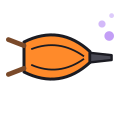

<p align="center"></p>

<h1 align="center">forge</h1>

<p align="center"><b>a little workshop of custom firmware for CHOMPI</b><br>
some of it is magic. most of it is just really fun to play.</p>

<p align="center">by <b>DeeCee</b>, built with Claude</p>

<p align="center"><sub><i>Forge is independent community firmware, not affiliated with or endorsed by CHOMPI Club.
CHOMPI is a trademark of CHOMPI Club. See <a href="TRADEMARKS.md">TRADEMARKS.md</a>.</i></sub></p>

---

## so what's forge?

Forge is where new firmware for CHOMPI gets hammered out. It's a family: every firmware
that comes out of the workshop gets its **own name and its own mascot**, and they all live
here, on the Forge tree.

| firmware | mascot | what it is | status |
| --- | --- | --- | --- |
| **Choowi** | Choowi, the magic blacksmith | a playable synth, sampler and looper that plays chords for you, keeps time, remembers and dreams | the first one. living on CHOMPI right now |
| *the next one* | *a new face* | *still glowing on the anvil* | *someday* |

The house rules (names, mascots, tools, colours) are in
[FORGE_FAMILY.md](docs/forge/FORGE_FAMILY.md).

## meet Choowi

Choowi is a square with spiral eyes, a chewy grin, a crooked wizard hat and a hammer that
throws sparks. He turned CHOMPI into an instrument that does a surprising amount of the
work for you:

- **it wakes up singing.** switch it on and your last sound comes back with a little chime.
- **one key, a whole chord.** turn on harmony and every key plays a chord in your key. the
  keys even light up in the chord's colour, so you can see what's happy and what's moody.
- **an arp and a bass player** that follow along on CHOMPI's clock (or your DAW's).
- **out of ideas?** hold two knobs and Choowi forges you a brand-new sound. hold two others
  and the sound you have drifts a little. record anything, then roll, and it becomes an
  instrument.
- **leave it alone** for a couple of minutes and it starts dreaming quietly in your key.
- **design sounds right on the panel** (the synth page), or describe one to an AI on your
  computer and send it over.
- **everything TAPE does stays.** the sampler, recording, the looper and TAPE's menu all
  work the way your hands already know.

New here? Start with the [guide](docs/forge/GUIDE.md): "how do I save a sound", "how do I play
chords" and friends, step by step. The whole tour, with pictures: the
[illustrated manual](docs/forge/ILLUSTRATED_MANUAL.html) (open it in a browser), and every detail
in the [user manual](docs/forge/MANUAL.md).

## Choowi's toolbox

Every Choowi release is a magic tool he forges, in the next colour of CHOMPI's panel lights.

| | release | tool | what it brought |
| --- | --- | --- | --- |
|  | 0.16 | Colour Lantern | every menu page and setting shows its colour, so you never get lost |
|  | 0.17 | Wake-up Bell (and a lucky die) | the wake-up chime, surprise me, mutate |
|  | 0.17.1 | Sweep Brush | the filter knob actually sweeps now |
|  | 0.18 | Dream Bellows | dream mode, chomp to instrument, sparkles and ripples |
|  | 0.19 | Tinker Wrench | the synth page: build a sound on the panel |

Everything before 0.16 (the synth, the TAPE sampler and looper, harmony, the arp, the event
recorder, presets, the sound workshop) is Choowi's foundation. The full story is in the
[changelog](docs/forge/CHANGELOG.md).

## put it on your CHOMPI

No apps, no accounts. Just the SD card.

1. **Download `FORGE.bin`** from this repository's **Releases** page (the newest Choowi).
2. **Charge CHOMPI** until the battery light is green or white (hold SW6 for 2 seconds).
3. **Back up the SD card**, then rename every file in its top folder whose name has `.bin`
   in it (CHOMPI installs the first one it finds): `CHOMPI_TAPEv2_0.bin` becomes
   `CHOMPI_TAPEv2_0_bin.old`.
4. **Copy `FORGE.bin`** to the card's top folder, card back in, switch on.
5. Rainbow lights while it installs, then Choowi says hi. Done.

**Updates** work the same way: drop the new `FORGE.bin` on the card (replacing the old
one) and switch on. Tinkerers on Windows can also update over USB with Forge Bridge
([manual](docs/forge/MANUAL.md), section 2).

**Want stock TAPE back?** Rename TAPE's file back to `.bin`, remove `FORGE.bin`, switch on.
Nothing in Forge touches the bootloader.

## how real is it?

Honest answer: a lot of it has been checked on a real CHOMPI, some of it is waiting for a
pair of ears.

- **checked on hardware:** the panel, knobs and lights; the synth, sampler, recording and
  looper; harmony chords, the arp, bass and latch; the event recorder; page and chord
  colours; the wake-up chime, surprise me and mutate; a stress test (CPU peaks around 67 %,
  a 5,600-messages-a-second MIDI flood with nothing dropped, 40/40 preset save and load).
- **checked by hand on 0.19.2:** the synth page, page and setting colours, harmony, saving
  and recalling a sound, sample start / end; the owner tried most of the rest. The TAPE
  functions (recording, sampler, looper) get their final check before the release.
- **known issues:** on some power banks CHOMPI stops charging while it's switched on (charge it
  switched off); the battery colour on SW6 is a rough voltage check, only white means full.
- **still up to you:** how it sounds, how it feels, how fun the magic is.

Every check and result is written down in [TEST_RESULTS.md](docs/forge/TEST_RESULTS.md).

## make sounds with any chatbot

Choowi's sound workshop, on any computer (Python 3.10+):

```sh
python3 -m pip install -r firmware/chompi-forge/host/requirements.txt
python3 firmware/chompi-forge/host/forge_web.py
```

Open **http://127.0.0.1:8765**, describe a sound and copy the prompt into any chatbot (ChatGPT,
Claude, Gemini…). Paste its reply back, tweak the sound, save it as a JSON file. No API key, no
account, and the workshop doesn't talk to CHOMPI: it only makes and checks sounds.

## for tinkerers

```sh
make -C firmware/chompi-forge test         # the native and Python tests
make -C firmware/chompi-forge firmware     # FORGE.bin (GNU Arm Embedded 10.3-2021.10)
```

| where | what lives there |
| --- | --- |
| [firmware/chompi-forge/](firmware/chompi-forge/) | **Choowi**: the firmware (`core/`, `src/`), the computer side (`host/`: bridge, webapp, CLI), presets and tests |
| [docs/forge/](docs/forge/README.md) | everything written down: manuals, design notes, the protocol, test plans and results |
| [docs/forge/CONTINUE.md](docs/forge/CONTINUE.md) | where the work is right now (start here if you're continuing it) |
| [AGENTS.md](AGENTS.md) | the rules for AI helpers working in the workshop |
| the other `firmware/` folders | CHOMPI Club's original firmware (TAPE, TEMPO, WAVE, the bootloader), untouched |
| [hardware/](hardware/) | CHOMPI Club's hardware files, untouched |

---

## the original CHOMPI release

*Everything below is CHOMPI Club's own README for the release Forge builds on, kept as they wrote it.*


**CHOMPI** is a quirky chromatic sampler and tape-music instrument by
[CHOMPI Club](https://www.chompiclub.com).

This repo contains all of the production files, both hardware and firmware, that make up the CHOMPI Sampler.

---

## What's here

| | |
|---|---|
| [**Firmware — Start Here**](firmware/README.md) | Quick instructions for setting up your development environment, building the firmware, and loading it onto your CHOMPI. |
| [`firmware/chompi-wave`](firmware/chompi-wave/) | **WAVE 1.0**, a wavetable synth firmware that doubles as a starting point for anyone writing their own firmware. |
| [`firmware/chompi-tempo`](firmware/chompi-tempo/) | **TEMPO 1.0**, a pattern generator firmware — the counterpart to TAPE. |
| [`firmware/chompi-tape`](firmware/chompi-tape/) | **TAPE 2.0**, the sampler firmware every CHOMPI ships with. |
| [`firmware/chompi-bootloader-v6.4-beta`](firmware/chompi-bootloader-v6.4-beta/) | This bootloader never shipped on units, but was created to improve stability of the Daisy Seed's integration with CHOMPI's hardware as well as repair edge-case issues related to bugs inherited from older versions of the Electrosmith bootloader.  |
| [`firmware/card-profiles`](firmware/card-profiles/) | The factory microSD card contents for TAPE, TEMPO and WAVE — firmware, samples and settings. |
| [`hardware/hardware-pcb`](hardware/hardware-pcb/) | Schematic, BOM, EAGLE PCB files, and the full fabrication package. |
| [`hardware/hardware-enclosure`](hardware/hardware-enclosure/) | The six pcb panel enclosure files, as well as laser cutting files for diy panels. |

Each folder contains its own README, so check those out for more details.

## What's not here

**The panel artwork.** The graphic set and CHOMPI logos have all been removed for copyright purposes. If you choose to create your own hardware, we ask that you name it something else to avoid trademark infringement.

## Support Guidelines

This is a discontinuation open-source release. As such, this repo is intended to be a permanent source for files and documentation, and will likely not be receiving updates in the future. If you wish to customize your own project, we recommend cloning this repo into your own GitHub.

## Community

Even though this version of CHOMPI is now discontinued, the CLUB is expanding. If you want to discuss this project, share your creations, see what other users have made on their CHOMPI, feel free to check out the CHOMPI Open Source channel on the Chase Bliss Discord.

## License

Everything here is **MIT** — see [`LICENSE`](LICENSE). [`THIRD_PARTY.md`](THIRD_PARTY.md) lists
the work this builds on and the notices that come with it. The CHOMPI name, logo and artwork are
not covered by the license — see [`TRADEMARKS.md`](TRADEMARKS.md).

## HAPPY CHOMPIN'

---
